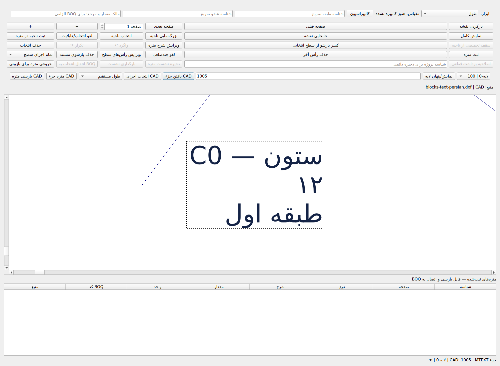
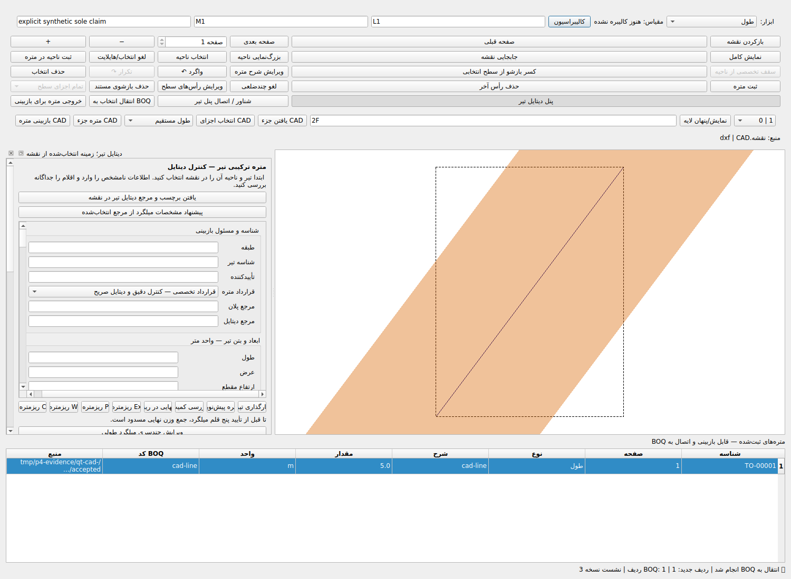

# فاز ۲، اولویت ۴ — تحویل اجرایی CAD، ۲۰۲۶-۱۰-۲۱

**نتیجه کلی: PARTIAL.** DXF، تبدیل واقعی یک DWG پشتیبانی‌شده و اتصال Entity مستند به SQLite/BOQ آزموده شدند. دامنه کامل حرفه‌ای به علت محدودیت‌های زیر بسته نمی‌شود. وارد اولویت ۵ نشده‌ایم.

## مبنا و هویت نسخه

HEAD آغاز: `8e3d1b701efafa32b235113de7aceeab49e9238c`؛ PR18 محفوظ: `3434f63ee3718f6399bbf06bc8ca7a2c6a835b29`.
کد آزموده محلی: `1fcc673f0dd16a91dc0ed347a50dde722bad92f8`؛ همان درخت در Commit GitHub `04b02f44e44ee2c988c5e6641a442f05da7f0e60`:
`8eddf0bffda4f9e65467a1e6e732ae78994559bc`.
Commit تحویل حاوی این سند فقط شواهد است؛ SHA آن از Git دریافت می‌شود و زیر‌درخت‌های اجرایی/آزمون با نسخه بالا برابرند. تفاوت SHA محلی و GitHub به metadata Commit مربوط است، نه درخت کد.

## مسیر واقعی و قابلیت‌های حفظ‌شده

`app/graphical_takeoff.py → DrawingViewerModel → DWGTakeoffEngine → ezdxf / ACadSharp bridge → DrawingTakeoffSession → existing application/ProjectStore → BOQ`.
CADAdapter قدیمی و providerهای مرزی از مسیر GUI متمایزند؛ موتور یا دفتر مالی موازی ساخته نشد. PDF، سه سقف، هندسه دقیق، اصلاحیه و قفل‌های قبلی در رگرسیون جامع محفوظ‌اند. Schema، بانک خانواده، قیمت، هشت فاز و PR18 تغییر نکردند.

## تغییرات واقعی و علت

- هندسه: مساحت مربع واحد در مختصات 1e12 قبلاً 134217728 می‌شد؛ چندضلعی مستقیم اکنون از قرارداد دقیق موجود استفاده می‌کند. طول و منحنی هنوز double با tolerance آزمون‌شده‌اند، نه ادعای Decimal مطلق.
- DXF: Handle خام تکراری/هم‌ارز قبل از repair ezdxf رد می‌شود؛ مختصات نامتناهی، Z و extrusion نامعتبر، لایه/والد پنهان و واحد نامعلوم مانع مالی‌اند. Blockهای تو‌در‌تو با Transform و مسیر Handle، محدودیت عمق۳۲ و ۲۵۰هزار expanded Entity دارند. چرخه و MINSERT رد می‌شوند.
- DWG: SHA اصل با SHA DXF مبدل اشتباه نمی‌شود؛ ابزار/نسخه/Exit و SHA خروجی ثبت می‌شوند. Timeout، تغییر فایل حین تبدیل و خروجی نامعتبر رد می‌شوند. `--version` به bridge واقعی افزوده شد.
- GUI واقعی: فهرست لایه با تعداد، hide/show، جست‌وجوی Handle، انتخاب با کلیک، Highlight، متره Entity و بازبینی مستقل، ذخیره و BOQ. خطای پاک‌شدن انتخاب در mouseRelease رفع شد. tolerance چهار پیکسل فقط برای انتخاب دیداری است.
- فارسی: جای baseline، cap height، rotation و MTEXT anchor/width اصلاح شد. MTEXT فاقد width مجاز است؛ عدم وجود فونت اصلی با هشدار جایگزین همراه است. تصویر واقعی متن متصل و چندخطی بازبینی شد؛ تطابق SHX ادعا نمی‌شود.
- مالی: فقط LINE و POLYLINE مستقیم XY معتبر به طول/سطح Entity متصل‌اند. برداشت CAD بدون binding پیش‌نویس می‌ماند؛ بازبین مستقل، مدرک، طبقه/عضو/مالک، منبع و digest دوباره بررسی می‌شوند. تغییر کد، مبدأ نمایش، نشست یا نام عضو مجوز پرداخت دوم نیست. price_code از کد عملیات اختراع نمی‌شود. اصل قطعی و قفل مالی محفوظ‌اند؛ اصلاحیه CAD چندضلعی ۱۲→۱۵ از دفتر نسخه‌دار موجود آزموده شد.

## آزمون‌های اجراشده

| اجرا | PASS | FAIL | ERROR | SKIP | Exit |
|---|---:|---:|---:|---:|---:|
| Baseline CAD |67|0|0|0|0|
| هدفمند نهایی |97|0|0|0|0|
| جامع نهایی؛ 333.99 ثانیه |7469|0|0|5|0|

اعداد هم‌پوشان‌اند و جمع نمی‌شوند. ۴۷ سناریوی جدید داخل جامع‌اند. پنج Skip فقط نبود PowerShell؛ دو هشدار قدیمی JUnit/record_property. آزمون قدیمی حذف، تضعیف یا Skip اجباری نشد.

```bash
QT_QPA_PLATFORM=offscreen python -m pytest -q -ra --junitxml=/tmp/p4-evidence/phase2_priority4_final.xml
python -m compileall -q core app tests
python -m pip check
git diff --check
```

اجرای نهایی پس از آخرین تغییر کد انجام شد. فرمان دقیق هدفمند و شکست‌های قرمز/سبز و Exitهای میانی در ZIP تشخیصی‌اند. اجرای جامع میانی سه شکست سازگاری و سپس یک شکست MTEXT بدون عرض داشت؛ همه رفع و جامع نهایی تکرار شد. اجراهای متوقف‌شده Exit130 پذیرش محسوب نمی‌شوند.

## Oracle و DWG واقعی

DWG مصنوعی باینری واقعی AC1032 با DwgWriter ساخته و با DwgReader از ACadSharp 3.8.0/assembly3.8.0.0، MIT، تبدیل شد. DXF مرجع مستقل دارای خط۳-۴-۵، مستطیل۴×۳، دایره شعاع۲ و Block چرخیده است؛ شش Entity expanded قبل/بعد حفظ شدند. طول‌ها۱ و۵متر، مساحت۱۲مترمربع و دایره4π با خطای مجاز1e-12 آزموده شدند. در مختصات بزرگ، مساحت مربع۱ دقیق است؛ واحدهای m/mm/cm/in/ft با ضرایب مستقل کنترل شدند. mixed fixture طول مرجع10000m و actual10000m، اختلاف صفر، حد1e-8 دارد.

ابزار موجود با .NET SDK8.0.426 در Linux واقعاً build و اجرا شد؛ build پیش‌فرض به محدودیت Process.GetStat محیط برخورد کرد، اجرای مستقیم MSBuild موفق شد. فقط DLL managed آزمایشی، بدون Windows EXE/Release. SDK وابستگی اجباری DXF نیست. نسخه، مجوز و هش‌ها در JSON و receipt هستند. فایل جعلی تغییرپسوندداده‌شده استفاده نشد.

سناریوی واقعی نرم‌افزار با همین DWG: Entity با Handle30، خط۵متر → پیش‌نویس → رد بدون بازبینی → بازبینی مستقل مصنوعی → BOQ۵متر بدون قیمت → بستن/بازگشایی. CAS کهنه، فایل تغییرکرده و همان Entity در نشست دیگر با مبدأ متفاوت رد شدند؛ SQLite integrity=ok و BOQ هنگام رد ثابت ماند. این شاهد نرم‌افزاری مصنوعی است، نه امضای مهندس یا نقشه مصوب.

## کارایی اندازه‌گیری‌شده

| Entity | بایت فایل | ورود/رندر مسدودکننده، ثانیه | peak RSS KiB | طول مرجع/واقعی متر |
|10000|1254618|0.620|148712|50000 / برابر|
|50000|6305738|3.677|325408|250000 / برابر|
|100000|12654172|6.913|549120|500000 / برابر|

تمام Entityها حفظ شدند. زمان hide/show،۲۰ zoom و Handle lookup در JSON ثبت است. mixed:۲۰۰۰ Insert،۱۰۰۰ متن فارسی،۵۰لایه و۵۰۰۰ expanded؛ ۰٫۶۷۵ثانیه و۱۵۰۳۴۰KiB. این اعداد روی میزبان فعلی و هم‌زمان با بار آزمون‌اند؛ SLA یا ظرفیت نامحدود نیستند. ورود اولیه synchronous است و معیار پاسخ‌گویی حین بارگذاری کامل نشده است.

## محدودیت‌های صریح و وضعیت

- بارگذاری و رندر اولیه همگام و مسدودکننده رابط است؛ پذیرش پاسخ‌گویی هنگام ورود فایل حجیم کامل نیست.
- MINSERT، XREF حل‌نشده، HATCH، DIMENSION، SPLINE، Proxy و اندازه‌گیری مالی منحنی‌ها کامل نیستند؛ مسیر پشتیبانی‌نشده رد یا با هشدار مشخص می‌شود.
- واحد نامعلوم یا INSUNITS=0 برای BOQ مسدود است؛ فرم تعیین واحد با مدرک مستقل افزوده نشده است.
- فرزندان Block با Transform و مسیر Handle پشتیبانی می‌شوند؛ انتخاب/پرداخت تجمعی خود Block کامل نیست.
- فونت جایگزین با هشدار؛ تطابق کامل SHX اصلی، alignment پیچیده و Windows تأیید نشده‌اند.
- تنها DWG مصنوعی واقعی AC1032 با ACadSharp 3.8.0.0 آزموده شد؛ همه نسخه‌ها، فایل رمزدار، مشتری و نقشه مصوب پذیرفته نشده‌اند.
- کنترل پیش از تعمیر Handle روی DXF متنی است؛ پشتیبانی جامع Binary DXF احراز نشده است.

DXF/واحدها/لایه‌ها/متن/نقشه حجیم/CAD→BOQ در دامنه‌های بالا **PARTIAL**؛ DWG واقعی در AC1032 مصنوعی **COMPLETE محدود به نمونه و decoder اعلام‌شده**، پوشش عمومی DWG **PARTIAL**. رگرسیون جامع PASS. وضعیت کلی اولویت۴ PARTIAL باقی می‌ماند؛ موفقیت DXF جای DWG یا Windows نیست.

## شواهد و بازیابی

پوشه assets هم‌نام شامل لاگ جامع، JUnit فشرده، هدفمند، رسید DWG و SQLite، Benchmarks، CAD مصنوعی و تصاویر واقعی Qt است. JSON همراه SHA-256 تک‌تک فایل‌ها و هویت Commitها را دارد. ZIP تشخیصی شکست‌ها و probeهای مستقل را حفظ می‌کند. بکاپ نهایی Git bundle و داده‌ها در Dropbox و رسید مستقل بازدریافت/بازیابی جداگانه ثبت می‌شود؛ این سند پیشاپیش موفقیت آن را ادعا نمی‌کند.




## Commitها و فایل‌ها

- [64b142a8](https://github.com/Asanda021/StructuralPro-Recovery/commit/64b142a87aa4761debdba460ab8c2b3b1fa1d679) — fix: preserve CAD units, block identity and planar safety with native layer controls [skip ci]
- [1ea6acbb](https://github.com/Asanda021/StructuralPro-Recovery/commit/1ea6acbb327ecb04abfa32f86bc43c9a7c4b4b8b) — feat: bind reviewed CAD entities to existing SQLite BOQ and correction guards [skip ci]
- [be20c6d0](https://github.com/Asanda021/StructuralPro-Recovery/commit/be20c6d05d4a4e85d7da9d49b73eda1e76c8cf9e) — fix: retain nonfinancial CAD previews and original mesh blockers [skip ci]
- [96ec84c3](https://github.com/Asanda021/StructuralPro-Recovery/commit/96ec84c3840358e2364865525d2aa15227c591da) — fix: reject hexadecimal handle aliases before DXF identity repair [skip ci]
- [fe4ca7fa](https://github.com/Asanda021/StructuralPro-Recovery/commit/fe4ca7fa846c1c55e4a2c887570db042456b05d4) — fix: anchor Persian CAD text and rotation to source coordinates [skip ci]
- [d5224d47](https://github.com/Asanda021/StructuralPro-Recovery/commit/d5224d47f0f1645fb4b1328c9bb786f1d5c86b11) — fix: select CAD hairlines with display-only device tolerance [skip ci]
- [d466382e](https://github.com/Asanda021/StructuralPro-Recovery/commit/d466382ed51488212157eab3bb0bcd953590fb40) — fix: retain explicit CAD selection through mouse release [skip ci]
- [04b02f44](https://github.com/Asanda021/StructuralPro-Recovery/commit/04b02f44e44ee2c988c5e6641a442f05da7f0e60) — fix: bind CAD identity independently of codes and keep optional MTEXT width [skip ci]

- `app/graphical_takeoff.py`
- `core/cad/external_dwg_provider_v1.py`
- `core/drawings/dwg_converter.py`
- `core/drawings/dwg_takeoff.py`
- `core/drawings/takeoff_bridge.py`
- `core/drawings/takeoff_session.py`
- `core/platform/application.py`
- `core/takeoff/manual_formula_amendments.py`
- `scripts/phase2_priority4_cad_probe.py`
- `tests/test_phase2_priority4_cad.py`
- `tools/acadsharp-dwg-bridge/Program.cs`

PR20 باید Open/Draft، PR18 و main بدون تغییر بمانند. بدون Merge/Force Push/Actions دستی/Release/EXE؛ Windows/Office و نقشه واقعی تأیید نشده‌اند. در همین اولویت متوقف می‌شویم.
