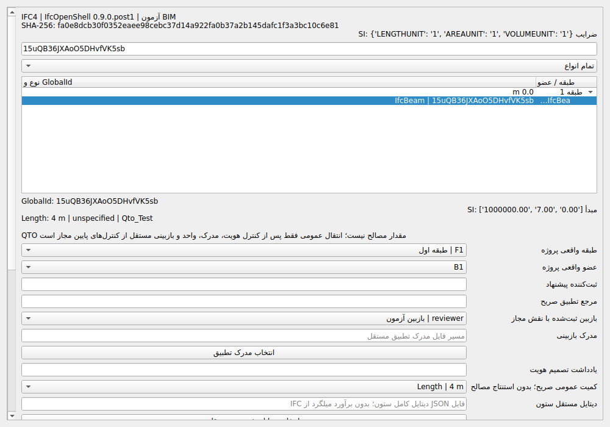
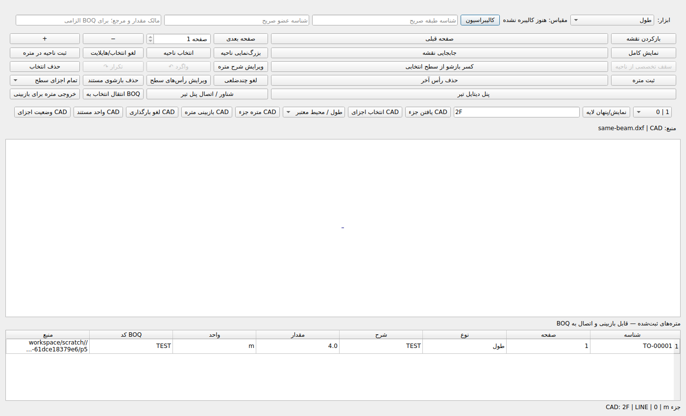

| معیار | وضعیت | شواهد و مانع |
|---|---|---|
| A | COMPLETE | IFC4 واقعی، IfcOpenShell 0.9.0.post1، کنترل SHA، Schema، هویت و واحد؛ آزموده‌شده در همین اجرا.  |
| B | COMPLETE | Placementهای صلب محلی و تبدیل صریح SI متر/میلی‌متر؛ MapConversion و Schemaهای دیگر پذیرفته‌شده معرفی نشده‌اند.  |
| C | PARTIAL | نقش مجاز و بازبین مستقل، رویدادهای تغییرناپذیر SQLite، CAS، Revision یک‌به‌یک با GlobalId ثابت/جدید و رد مالک ناسازگار. آشتی کامل Split/Merge و ماتریس همه حالات تغییر مالکیت و مقدار تحویل نشده است. |
| D | COMPLETE | QTO عمومی و مسیر کامل دیتایل مستقل ستون از موتور موجود؛ بازشوی واقعی، مرجع تحلیلی مستقل و آزمون تضاد؛ بدون استنتاج مصالح از Mesh.  |
| E | PARTIAL | Crosswalk بازبینی‌شده PDF/CAD، انتخاب دوطرفه واقعی CAD/IFC و همگامی فهرست/فرم، کنترل پرداخت دوم از منابع مختلف. مهاجرت مثبت Crosswalk نسخه جدید، سناریوی کامل IFC/DWG تبدیل‌شده و تمام تعاملات PDF و Split/Merge تکمیل یا اثبات نشده‌اند. |
| F | PARTIAL | متره عمومی IFC از دفتر فرمول و BOQ موجود، اصلاحیه API با حفظ اصل ۴ و مقدار مؤثر ۵، و دیتایل مستقل ستون تا BOQ. گردش کامل اصلاحیه IFC در Qt و مهاجرت منبع/دیتایل تخصصی نسخه جدید تحویل نشده است. |
| G | BLOCKED | رگرسیون دقیق Tree نهایی و بکاپ مستقل ثبت شدند؛ بازیابی ۱۱۳ PASS است. وقفه ۰٫۵۴۴۷۲۳۹۲۸ ثانیه در آزمون جامع صد‌هزارعضوی، بیشتر از حد ثابت ۰٫۵۰۰ ثانیه است. |

# اولویت ۵ فاز ۲ — تحویل اجرایی PARTIAL، ۲۰۲۶/۱۰/۲۲

**اولویت ۵ بسته نشده است.** موانع C، E و F نرم‌افزاری/آزمونی‌اند؛ G نیز در اجرای جامع نهایی شکست دارد. این موارد به فقدان نقشه مشتری تقلیل داده نمی‌شوند.


## کد و آزمون دقیق

- HEAD آغاز مأموریت: `75d344171049c2c6ddfda7d51409bdc2d99b5bf8`؛ آغاز این ادامه: `2941c795882257c4fafd0cf9a3a391fe04b188ec`.
- HEAD اجرایی منتشرشده: `62bbccba2b27fae856b2083ab26e6927ee992756`؛ کاندید محلی آزموده: `4efceed633a9069cad9179f0862aaba24ec8859a`؛ Tree یکسان: `04c5216d1bb46bea13c47b24265464ec3e4c3c44`.
- Commit حامل گزارش فقط اسناد/شواهد است؛ SHA همان Commit از تاریخچه Git و پاسخ تحویل مشخص می‌شود.

هدفمند نهایی: **117 PASS / 0 FAIL / 0 ERROR / 0 SKIP / Exit 0**.
جامع نهایی: **7585 PASS / 1 FAIL / 0 ERROR / 5 SKIP / Exit 1**. پنج Skip فقط PowerShell هستند. نتایج هدفمند، جامع و بازیابی هم‌پوشان‌اند و جمع نمی‌شوند.

```bash
QT_QPA_PLATFORM=offscreen python -m pytest -q tests/test_phase2_priority4_closure.py tests/test_phase2_priority5_closure.py tests/test_phase2_priority5_ifc.py
QT_QPA_PLATFORM=offscreen python -m pytest -q -ra --junitxml=closure-final.xml
python -m compileall -q core app tests
python -m pip check
git diff --check
```

Compileall، pip check و diff check موفق‌اند. هیچ آزمون قبلی حذف، ضعیف یا Skip اجباری نشده؛ فایل حد ۵۰۰ms بدون تغییر مانده است. JUnit و لاگ کامل فشرده در پوشه شواهد موجودند.

## نقص واقعی پاسخ‌گویی

ردیابی اجرای جامع نشان داد وقفه ۵۸۳٫۰۹ms هنگام دریافت مدل رخ داد و ۵۶۸٫۵۳ms آن جمع‌آوری نسل دوم GC بود. آزادسازی پنجره بسته‌شده و حذف `__dict__` هر رکورد CAD پیاده شدند، اما مشکل کامل حل نشد. نمونه ۱۰۰۰ رکورد از ۱۵۲٬۰۰۰ به ۶۴٬۰۰۰ بایت سربار رکورد کاهش یافت؛ این عدد RAM کل برنامه نیست. تنظیم GC، ورودی ۱۰۰هزار و حد ۵۰۰ms تغییر نکردند. اجرای آزمایشی هنوز ۵۱۵٫۴۶ms و اجرای نهایی **۵۴۴٫۷۲ms** ثبت کرد. G همچنان BLOCKED است.

## آنچه واقعاً کار می‌کند

- پیشنهاد هویت به عضو و طبقه موجود، نقش‌های هسته همکاری، بازبین مستقل، SHA مدرک، زمان/رویداد/Revision، بازگشایی SQLite و رد CAS کهنه. یک GlobalId ثابت نمی‌تواند در Revision جدید به عضو ناسازگار متصل شود؛ آزمون قرمز/سبز ثبت شده است.
- QTO عمومی صریح با فرمول `Q` در خانواده موجود `manual_workbench` وارد دفتر فرمول، بازبینی و BOQ موجود می‌شود؛ قیمت ساخته نمی‌شود. کمیت عمومی، مقدار مصالح یا حجم محاسبه‌شده از Mesh نیست.
- IFC واقعی دارای بازشو و رابطه IfcRelVoidsElement: مرجع مستقل `4 × .2 × 3 = 2.4 m3` و کسر `1 × .2 × 2 = .4 m3`؛ خالص `2 m3`. خروجی هندسه ناخالص `2.4000000000000004` و خالص `2.0` است؛ اختلاف و کران در JSON ثبت شده‌اند. اختلاف QTO مردود می‌شود.
- ستون با دیتایل فایل مستقل در موتور تخصصی موجود: بتن `0.6 m3`، قالب `2.7 m2` و میلگرد صریح `21.488 kg`؛ IFC این دیتایل‌ها را حدس نمی‌زند.
- Crosswalk ثبت‌شده PDF/CAD با IFC، بررسی نقطه مرجع و تبدیل صلب SI، مدرک و بازبین مستقل؛ کلیک واقعی CAD، مدل و فهرست/فرم IFC را همگام می‌کند. تغییر منبع، مدرک، تبدیل غلط، CAS و ثبت دوم رد می‌شوند.
- دفتر اصلاحیه موجود: QTO منبع R1 از ۴ به QTO منبع R2 با GlobalId جدید و مقدار ۵ اصلاح می‌شود؛ اصل متره/دفتر قطعی ۴ باقی می‌ماند و BOQ مؤثر ۵ است؛ اعمال تکراری رد می‌شود. این نمونه، رفتار دفتر اصلاحیه را اثبات می‌کند؛ تأیید مستقل هندسه همه QTOهای طولی یا طراحی واقعی نیست.

## پروژه‌ها و خروجی واقعی

SQLite پروژه اصلی یک متره عمومی ۴متری، یک ردیف BOQ بدون قیمت و یک Crosswalk تأییدشده آزمایشی دارد. پایگاه‌های نمونه ستون و اصلاحیه نیز در ZIP موجودند. چهار خروجی PDF/Excel/Word/CSV واقعاً تولید و بازخوانی شدند؛ مقدار و واحد با SQLite تطبیق داده شد. شیت‌های Excel RTL هستند، Word/CSV محتواخوانی شدند و صفحه نماینده PDF رندر و دیداری بررسی شد؛ بازبینی Microsoft Office ادعا نمی‌شود.





## Commitها و فایل‌ها

- [a8b5ba97](https://github.com/Asanda021/StructuralPro-Recovery/commit/a8b5ba977ae12710b9ae7d863a8afe5a0f3d8689) — fix: release closed drawing workspaces and their retained large Qt scenes [skip ci]
- [367e7997](https://github.com/Asanda021/StructuralPro-Recovery/commit/367e7997d3d5b234ce09fdf6f7a6adf3f2ab927b) — feat: review IFC identity proposals with existing collaboration roles and immutable SQLite history [skip ci]
- [949fb727](https://github.com/Asanda021/StructuralPro-Recovery/commit/949fb727b297aa0d73ef4f2a60d38f4bec8f67e1) — feat: connect reviewed IFC quantities and crosswalks to canonical takeoff workflows [skip ci]
- [d06f2c8c](https://github.com/Asanda021/StructuralPro-Recovery/commit/d06f2c8c29e668a05d5043e5c265d17ef077088c) — fix: stop linked selection callbacks when Qt scenes are being destroyed [skip ci]
- [2941c795](https://github.com/Asanda021/StructuralPro-Recovery/commit/2941c795882257c4fafd0cf9a3a391fe04b188ec) — fix: retain IFC identity events and resolve PDF ownership across sessions and operation codes [skip ci]
- [c728fbd2](https://github.com/Asanda021/StructuralPro-Recovery/commit/c728fbd2a470010e6dbaf1d22fadf9971ed58b61) — perf: reduce retained CAD entity record allocations without changing source geometry [skip ci]
- [d08a40f9](https://github.com/Asanda021/StructuralPro-Recovery/commit/d08a40f9d65a1dc6cb0d4ca2bbc4a5c157e68c9e) — fix: reject conflicting IFC GlobalId owners across source revisions [skip ci]
- [62bbccba](https://github.com/Asanda021/StructuralPro-Recovery/commit/62bbccba2b27fae856b2083ab26e6927ee992756) — fix: synchronize IFC inspector state with linked drawing and model selections [skip ci]

فایل‌های محصول/آزمون: `app/graphical_takeoff.py`, `app/main.py`, `core/drawings/bim_quantities.py`, `core/drawings/dwg_takeoff.py`, `core/drawings/ifc_pipeline.py`, `core/platform/application.py`, `core/projects/store.py`, `core/takeoff/commit_guards.py`, `core/takeoff/manual_formula_amendments.py`, `core/takeoff/manual_formula_register.py`, `core/takeoff/reviewed_structural.py`, `tests/test_phase2_priority5_closure.py`.

## محدودیت‌های پذیرش باقی‌مانده

1. C: آشتی کامل Split/Merge، مالکیت کمیت و ماتریس کامل تغییرات اعضا تحویل نشده است؛ ارتباط یک‌به‌یک موفق معادل آن نیست.
2. E: مهاجرت مثبت Crosswalk نسخه جدید، سناریوی کامل IFC/DWG/DXF و تمام تعاملات PDF در Qt تکمیل/اثبات نشده‌اند؛ مسیر کهنه یا مبهم مجوز پرداخت نمی‌گیرد.
3. F: گردش کامل اصلاحیه IFC در Qt و مهاجرت منبع/دیتایل تخصصی نسخه جدید تحویل نشده است؛ موفقیت API عمومی جای آزمون این موارد نیست.
4. G: آزمون جامع صد‌هزار Entity هنوز ناموفق است؛ علت GC مستند است اما کران پاسخ‌گویی برآورده نشده.

داده‌ها و نقش‌ها مصنوعی و صریح‌اند؛ امضای طراح، صلاحیت حرفه‌ای یا پذیرش نقشه مشتری نیستند. Windows/Office خارج از پذیرش این اجرا باقی ماندند. هیچ اولویت ۶ یا فاز جدیدی آغاز نشد.

## بکاپ

بکاپ اصلی: `/StructuralPro/Backups/StructuralPro_P5_Followup_62bbccba_20261022.zip`

SHA-256: `a2c5c85ae20a2fc7a40650f24a2a8cba2921ccdabaf2fc5e8e128de85fec779d`

بازدریافت واقعی، CRC، تطبیق 56 هش، Git bundle/fetch/fsck، HEAD/Tree، بازکردن IFC از نسخه بازگردانی‌شده، SQLite و انتخاب واقعی Qt در Crosswalk موفق‌اند. آزمون بازیابی مستقل: **113 PASS / 0 FAIL / 0 ERROR / 0 SKIP / Exit 0**. این نتیجه، شکست آزمون جامع را سبز نمی‌کند.

مسیرهای منبع در سوابق SQLite بازنویسی نشدند. در آزمون مستقل، نمونه‌های اصلی موقتاً کنار گذاشته شدند و نگاشت ریشه فقط به فایل‌های استخراج‌شده اشاره کرد؛ سپس نگاشت برداشته شد. همه مسیرهای استفاده‌شده داخل ریشه بازیابی بودند و هش تمام فایل‌های Manifest پس از بازخوانی نیز بدون تغییر ماند. سیاست نگاشت در Manifest مستند است.

این آرشیو، کد دقیق `62bbccba` و شواهد پیش از رسید را دارد. رسید و گزارش نهایی در Git ثبت و در بسته همراه اسناد نگهداری می‌شوند. وضعیت PR #20 باید Open/Draft باقی بماند؛ PR #18 و main تغییر نکرده‌اند.
