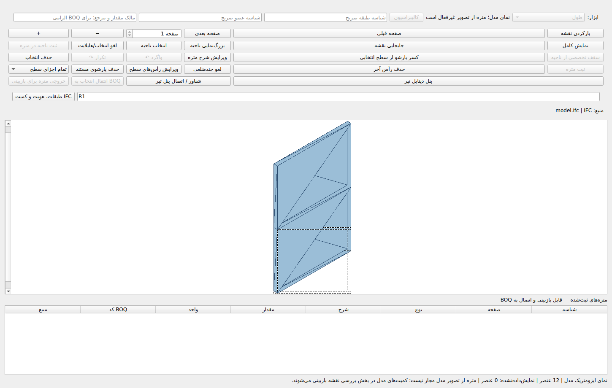
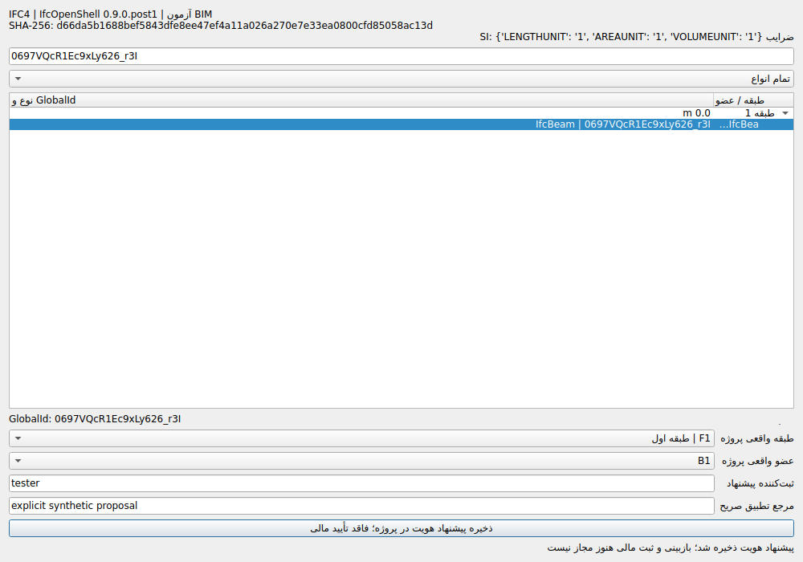

# فاز ۲، اولویت ۵ — تحویل واقعی PARTIAL، ۲۰۲۶/۱۰/۲۲

**اولویت ۵ بسته نشده است.** اصلاحات زیر اجرا و آزموده شدند؛ C، D، E و F هنوز نقص اجرایی دارند. این موانع صرفاً فقدان نقشه مشتری یا امضای مهندس نیستند. ورود به اولویت ۶ انجام نشد.

| معیار | وضعیت | شواهد / مانع |
|---|---|---|
| A | COMPLETE | Actual IFC4 / IfcOpenShell 0.9.0.post1, source SHA, SI engineering import. Other schemas not accepted by this evidence contract. |
| B | COMPLETE | Rigid IfcLocalPlacement chains, explicit SI m/mm conversions and source QTO units; local coordinates only. MapConversion and non-SI are unsupported and not used for crosswalk. |
| C | PARTIAL | Only proposed bindings to existing FloorID/MemberID persist. Independent identity approval, revision/split/merge reconciliation and physical ownership rules are not implemented. |
| D | PARTIAL | Exact explicit QTO preview is implemented. Independent solid/net geometry quantity verification and verified links to specialist detail calculators are not implemented. |
| E | BLOCKED | Persisted reviewed PDF/CAD–IFC crosswalk, bidirectional selection and cross-source physical-ownership reconciliation are not implemented. The companion DXF is an explicitly unreviewed fixture only. |
| F | PARTIAL | Actual native Qt inspection/highlight and SQLite/CAS proposals work. Independent IFC review, permitted BOQ posting and existing-journal IFC amendments are not implemented; the financial paths remain blocked. |
| G | BLOCKED | Final comprehensive run failed the unchanged 100000-entity CAD responsiveness test: 0.6173058429999401s > 0.5s. Restored targeted tests and backup integrity do not override this failure. |

## مبنا و کد آزموده

- HEAD اولیه: `aaad93cb6c77661bc60c221c39519d9399022825`.
- HEAD اجرایی نهایی: [cc67da69](https://github.com/Asanda021/StructuralPro-Recovery/commit/cc67da692cc0e74e5b667a45b41dce6c2ef51d80)؛ Tree دقیق `bc11b6e69c5423c7ddec2ee23ceeda4e54883f4c`.
- HEAD محلی آزموده: `e3aead281b3d9bd02e1063c0248c2880d717bf6e`؛ Tree با کد GitHub یکسان است.
- Commit حاوی این سند فقط مدارک را اضافه می‌کند. SHA تحویل نهایی در تاریخچه Git و پاسخ تحویل مشخص است؛ SHA سند به خودش نسبت داده نمی‌شود.
- PR #18 روی `3434f63ee3718f6399bbf06bc8ca7a2c6a835b29` حفظ شد. فقط PR #20 تغییر کرد؛ بدون Merge/Force Push/Actions دستی/Release/EXE.

## اصلاحات واقعی

1. [2570ed10](https://github.com/Asanda021/StructuralPro-Recovery/commit/2570ed103f84e24bbd2d7f3b5dc1b7b3fab9432d): خواندن مهندسی IFC4 در BIMAdapter موجود، SI، Placement، QTO، فرم Qt و پیشنهاد هویت متصل به پروژه؛ رفع دورزدن قفل تصویر IFC از API.
2. [021b0195](https://github.com/Asanda021/StructuralPro-Recovery/commit/021b0195b4e6e32c63426edb4e67372d024b76b0): رفع نمایش ۴۰۰۰ میلی‌متر به‌عنوان ۴۰۰۰ متر در UnifiedDrawingTakeoff؛ پیش‌نمایش صحیح ۴ متر و رد تبدیل مالی عمومی.
3. [4baf76c5](https://github.com/Asanda021/StructuralPro-Recovery/commit/4baf76c5a6dd32ad869b2d80a0bc47a4dc7a55ad): گسترش همان Worker CAD برای IFC، انتقال مرحله‌ای، مسیر نمایشی واحد برای هر Mesh؛ حفظ رقم `3.500000000000000014` در QTO به‌جای حذف آن در مرز Double.
4. [4b5a848c](https://github.com/Asanda021/StructuralPro-Recovery/commit/4b5a848c61843fa44eeeee037282b2fde73ee053): رد GlobalId غیرکانونی که Decoder کتابخانه آن را بدون خطا می‌پذیرفت.
5. [cc67da69](https://github.com/Asanda021/StructuralPro-Recovery/commit/cc67da692cc0e74e5b667a45b41dce6c2ef51d80): حذف بازخوانی فایل بزرگ و پیمایش یکجای صحنه در پایان بارگذاری؛ آزمون جامع قبل از اصلاح ۷۵۴۳ PASS / یک FAIL / پنج SKIP، با فاصله ۵۰۴٫۸ms بود. حد ۵۰۰ms تضعیف نشد. پروفایل مرحله نهایی و ۷۵ آزمون CAD/IFC پس از اصلاح ثبت شدند؛ اما اجرای جامع نهایی هنوز همان آزمون صد‌هزار Entity را با فاصله ۶۱۷٫۳ms رد کرد. این اصلاح برای رفع قطعی مشکل کافی نبوده است.

فایل‌های محصول/آزمون: `app/graphical_takeoff.py`, `core/drawings/bim_adapter.py`, `core/drawings/cad_import_worker.py`, `core/drawings/takeoff_bridge.py`, `core/drawings/unified_takeoff.py`, `core/platform/application.py`, `core/takeoff/workflow.py`, `tests/test_phase2_priority5_ifc.py`.

## آزمون‌ها

| اجرا | PASS | FAIL | ERROR | SKIP | Exit |
|---|---:|---:|---:|---:|---:|
| Baseline IFC موجود | 52 | 0 | 0 | 0 | 0 |
| هدفمند نهایی IFC/BIM | 86 | 0 | 0 | 0 | 0 |
| جامع Tree نهایی | 7543 | 1 | 0 | 5 | 1 |

اجرای جامع `353.089` ثانیه. نتایج هم‌پوشان جمع نمی‌شوند. ۳۴ آزمون جدید افزوده شد؛ آزمون پیشین حذف یا تضعیف نشد. پنج Skip فقط نبود PowerShell است؛ دو هشدار قدیمی record_property/JUnit نیز در لاگ آمده‌اند.

```bash
export QT_QPA_PLATFORM=offscreen
python -m compileall -q core app tests
python -m pip check
python -m pytest -q -ra --junitxml=phase2_priority5_ifc_final_accepted.xml
git diff --check
```

فرمان هدفمند: `pytest -q tests/test_phase2_priority5_ifc.py` به‌همراه ده فایل IFC نام‌برده در مأموریت؛ ۸۶ PASS. JUnit هدفمند و جامع، لاگ‌ها، خروجی بررسی وابستگی‌ها و لاگ‌های قرمز در پوشه assets موجودند. دو اجرای زودهنگام با Exit 130 متوقف شدند و PASS جامع محسوب نمی‌شوند. فایل JSON علت و نام لاگ آن‌ها را نگه می‌دارد.

## سناریو و Oracle مستقل

IfcOpenShell 0.9.0.post1 فایل STEP واقعی IFC4 را باز می‌کند: یک پروژه، یک ساختمان، دو طبقه، ۱۲ عضو از شش نوع Beam/Column/Slab/Wall/Footing/Member. هندسه صریح ۴×۰٫۲×۳ متر، Placement والد یک‌میلیون متری با دوران ۹۰ درجه، مبدأ عضو مورد انتظار `(1000000, 7, 0)` و طول QTO برابر ۴ متر. واحدهای متر/میلی‌متر و Override صریح QTO مستقل آزموده شدند؛ GrossArea=20 و NetArea=18 و NetVolume=2.4 از ورودی‌های صریح مستقل محاسبه شدند.

این Fixture، نقشه مصوب نیست. دیوار دارای بازشوی واقعی، تطبیق مصوب هندسه خالص و سناریوی کامل IFC→BOQ→اصلاحیه هنوز تکمیل نشده‌اند. DXF متناظر واقعی با خط ۴ متری و مرجع JSON تهیه شده، اما **Crosswalk تأییدشده نیست**.

Qt واقعی: کلیک روی عضو در درخت طبقات، جست‌وجوی GlobalId، فیلتر نوع، Highlight Mesh، نمایش QTO، انتخاب FloorID/MemberID موجود، ثبت پیشنهاد و بازگشایی SQLite؛ بدون Mock. در نمونه، یک پیشنهاد با وضعیت proposed و **صفر ردیف BOQ** وجود دارد؛ Integrity و CAS آزموده شدند. پیشنهاد هویت، رویداد محاسبه یا تأیید مالی جعلی نمی‌سازد.

## عملکرد

مسیر GUI انتخاب فایل IFC از QProcess موجود CAD استفاده می‌کند: Parser در پردازش مستقل، دریافت Mesh در بسته‌های ۱۰۰تایی، ساخت مسیر نمایشی هر Mesh روی رشته Qt در بسته‌های ۳۲تایی. همه مثلث‌های منبع حفظ می‌شوند. API همگام قدیمی برای سازگاری باقی است؛ Benchmark آن به‌عنوان رفتار قدیمی ثبت شده است. نمایش فقط برای بررسی است، نه اندازه‌گیری مالی.

| اعضا | بارگذاری async (ثانیه) | بیشترین فاصله Event loop (میلی‌ثانیه) | Peak RSS (KiB) |
|---|---:|---:|---:|
| 100 | 0.344 | 14.89 | 120676 |
| 1000 | 1.269 | 60.34 | 142052 |

آستانه ۵۰۰ms همان قرارداد درشت‌دانه میزبان Linux اولویت ۴ است، نه SLA ویندوز. پیش از اصلاح، بارگذاری همگام ۱۰۰۰ عضو فاصله ۱۴۶۵ms داشت. Timestampهای واقعی، حجم فایل و حافظه در JSONها ثبت شده‌اند. این Benchmark از هندسه تکراری مصنوعی استفاده می‌کند و مجوز مالکیت/پرداخت ندارد. ادعای ظرفیت نامحدود، پذیرش مدل پیچیده یا نبود هرگونه نشت حافظه نمی‌شود.

## کنترل مالی و محدودیت‌های واقعی

`ready=False`، `commit_allowed=False`، `payable_rows=[]` در مسیر جدید بررسی مهندسی IFC برقرار است. مسیر سرویسِ تصویر IFC و مسیر تأیید عمومی QTO مسدود شدند؛ قیمت ساخته نشد و دفتر/Schema مالی جدیدی ایجاد نشد. Scalar QTO به‌تنهایی مجوز مصالح نیست.

- C: بازبینی مستقل هویت، اصلاح طبقه، تغییر GlobalId و Split/Merge باید در همین اولویت تکمیل شوند.
- D: تطبیق مستقل هندسه و دیتایل تخصصی عضو، اختلاف Gross/Net و اتصال به موتورهای تخصصی هنوز تحویل نشده‌اند.
- E: Crosswalk تأییدشده، انتخاب دوطرفه و جلوگیری از پرداخت یک عضو از منابع PDF/CAD/IFC هنوز پیاده‌سازی نشده‌اند.
- G: آزمون جامع صد‌هزار Entity هنوز ناموفق است؛ محدودیت ۵۰۰ms تغییر نکرده و نیاز به ریشه‌یابی بیشتر در اجرای جامع دارد.
- F: ثبت مجاز IFC در BOQ، اصلاحیه از دفتر موجود و سناریوی کامل مالی هنوز پیاده‌سازی نشده‌اند؛ قفل مالی حفظ می‌شود.
- MapConversion، واحد غیرSI و Schemaهای دیگر در این قرارداد پذیرفته نشده‌اند؛ تأیید Windows/Office یا مدل مشتری اعلام نمی‌شود.

## شواهد و بازیابی

فهرست SHA-256 در JSON همراه آمده است. `phase2_priority5_ifc_assets/` حاوی JUnit فشرده، لاگ جامع، Benchmark قبل/بعد، Receipt سناریو، تصاویر واقعی Qt و لاگ‌های توسعه است.

بازیابی مستقل: {"archive_sha256": "de923b8cfc986fa1218c8542f0c095388c501d039626d0b04d542e43c370637f", "manifest_files": 66, "head": "cc67da692cc0e74e5b667a45b41dce6c2ef51d80", "tree": "bc11b6e69c5423c7ddec2ee23ceeda4e54883f4c", "git_fsck_exit": 0, "ifc_reopened": {"sha": "d66da5b1688bef5843dfe8ee47ef4a11a026a270e7e33ea0800cfd85058ac13d", "elements": 12, "storeys": 2, "values": ["4"]}, "sqlite_integrity": "ok", "boq_rows": 0, "identity_status": "proposed", "approved_crosswalks": 0, "passed": 86, "failed": 0, "errors": 0, "skipped": 0, "exit_code": 0, "status": "PASS for restore integrity, not complete priority5", "stored_document_paths_rewritten": false, "dropbox_path": "/StructuralPro/Backups/StructuralPro_P5_Partial_cc67da69_20261022.zip"}




