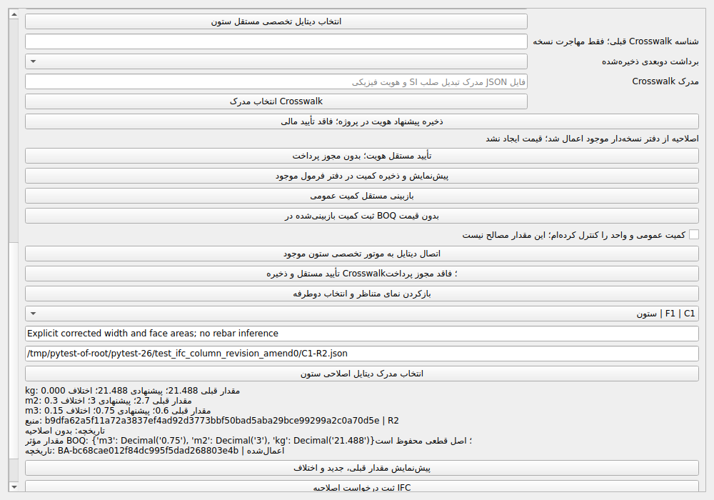
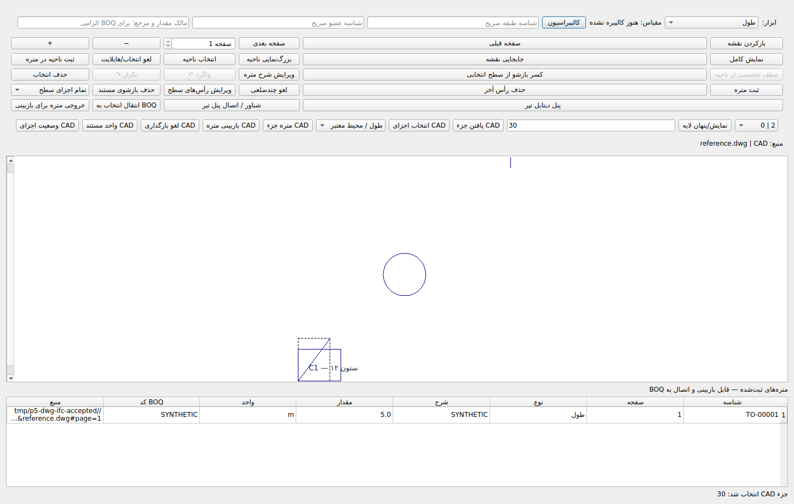
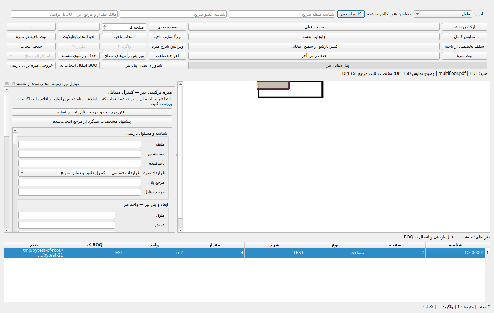

| معیار | وضعیت | شواهد واقعی | مانع |
|---|---|---|---|
| A. IFC معتبر | COMPLETE | IFC4 واقعی، Parser، SHA و رگرسیون | — |
| B. مختصات | COMPLETE | Oracle و تبدیل واحد موجود حفظ شد | — |
| C. هویت و Split/Merge | BLOCKED | دفتر موجود و آشتی عددی غیرمالی مستقل | انتقال مالی گروهی مالکیت قدیم/جدید پیاده‌سازی نشده است |
| D. کمیت‌های معتبر | COMPLETE | QTO و دیتایل کامل ستون از موتور موجود | — |
| E. Crosswalk | BLOCKED | مهاجرت یک‌به‌یک، PDF/DWG واقعی، Qt و SQLite | مهاجرت یک‌به‌چند/چند‌به‌یک Split/Merge تکمیل نشده است |
| F. IFC تا BOQ | COMPLETE | اصلاحیه عمومی و تخصصی با Qt، CAS، تاریخچه و بازگشایی | در دامنه عمومی و ستون مستند آزموده‌شده |
| G. آزمون و بازیابی | PASS | جامع ۷۶۳۲ PASS؛ بازیابی ۱۹۲ PASS؛ SHA و fsck | پنج Skip واقعی PowerShell |

اولویت ۵ همچنان **PARTIAL** است. موفقیت رگرسیون و بکاپ، نواقص C و E را بسته اعلام نمی‌کند. این دو نقص، تعهد نرم‌افزاری باقی‌مانده‌اند؛ به نبود نقشه مصوب مشتری نسبت داده نمی‌شوند. اولویت ۶ آغاز نشد.

## کد و تاریخچه

HEAD اولیه: `b3ecdaab7c546bbc77101dc04125246b459b6239`. HEAD کد نهایی: `b683ba614d5f013ba47a2f2c69e2f02cac431f40`. SHA محلی آزموده‌شده: `9eb9259036807733533b16b119a55096da79ee3a`. Tree دقیق مشترک: `3c4e48df0f61b16c6fb69da523fb783b4c60d582`. Commit اسناد فقط شواهد را اضافه می‌کند؛ SHA تحویل از تاریخچه همین فایل و رسید companion قابل بازیابی است. هفت Commit جدید مالک بدون بازنویسی، در ancestry حفظ شدند.

- [c9065086](https://github.com/Asanda021/StructuralPro-Recovery/commit/c9065086bdcd82a982bf3dac9722caf8f5102ba1) — fix: defer automatic full-heap GC only during active GUI imports and restore every terminal path [skip ci]
- [b64f37f0](https://github.com/Asanda021/StructuralPro-Recovery/commit/b64f37f06fa24c3f5e73b497c5877230935ca8e6) — feat: review IFC source migrations and native amendments while keeping unresolved split merge ownership fail closed [skip ci]
- [b683ba61](https://github.com/Asanda021/StructuralPro-Recovery/commit/b683ba614d5f013ba47a2f2c69e2f02cac431f40) — fix: show reviewed IFC member identity and applied amendment history in native inspector [skip ci]

فایل‌های محصول/آزمون: `app/graphical_takeoff.py`, `app/ifc_amendment_controls.py`, `core/drawings/gui_load_gc.py`, `core/drawings/ifc_lineage.py`, `core/drawings/ifc_pipeline.py`, `core/platform/application.py`, `core/takeoff/manual_formula_amendments.py`, `tests/test_phase2_priority5_gc_scope.py`, `tests/test_phase2_priority5_verified.py`. هیچ Schema یا موتور BOQ موازی ساخته نشد.

## اصلاحات و حدود واقعی

- CAD: تحلیل و دریافت Batch قبلی حفظ شد. آستانهٔ جمع‌آوری خودکار نسل دوم فقط در طول بارگذاری فعال بالا می‌رود؛ نسل صفر و یک فعال‌اند، `gc.disable/freeze` استفاده نشده و پس از آخرین بارگذاری تنظیمات دقیق قبلی برمی‌گردند. موفقیت، لغو، خطا، بستن و دو پنجره هم‌زمان آزموده شدند. GC کامل صریح همچنان ممکن است؛ توقف عمومی GC در زمان بیکار یا تمام محیط‌ها حذف‌شده ادعا نمی‌شود.
- سه اجرای پیاپی آزمون دست‌نخوردهٔ ۱۰۰هزار جزء، بیشترین وقفهٔ ۱۴۳٫۳، ۱۰۰٫۸ و ۹۴٫۴ میلی‌ثانیه داشتند. پس از بستن و جمع‌آوری حافظه در حالت بیکار، صفر `DWGEntity` باقی ماند. Peak RSS تجمعی همان پردازش حدود ۵۳۹۱۲۰ تا ۵۴۲۱۵۶ KiB بود؛ تضمین ظرفیت نامحدود نیست.
- Crosswalk یک‌به‌یک: مدرک SHA، تطبیق مستقل جانشین، همان مالک داخلی، Revision متفاوت و `supersedes` صریح لازم است. رکورد قدیم محفوظ و نسخه دوم Append-only است؛ UI نسخه جاری را باز می‌کند و نسخه کهنه رد می‌شود. متادیتای DWG و SHA خروجی DXF در Crosswalk محفوظ است.
- Qt: انتخاب عضو، شناسه داخلی بازبینی‌شده را در فرم نمایش می‌دهد. اصلاحیه عمومی و ستون از همان دفاتر موجود ساخته، بازبینی و اعمال می‌شوند؛ مقدار قبل/بعد/اختلاف، منبع، دیتایل و شناسه تاریخچه نمایش داده می‌شوند.
- ستون: دیتایل مستقل کامل نسخه جدید باید دقیقاً با JSON/SHA و جانشین بازبینی‌شده همان مالک مطابق باشد. اصل ریزمتره و رجیستر تغییر نمی‌کند. قیمت ساخته نمی‌شود؛ قفل مالی، بازبین مستقل، تغییر سند، ثبت دوم و Revision نامعتبر رد می‌شوند.
- Split/Merge: ارزیابی مستقل مقادیر واقعی QTO و جدول سهم‌ها اجرا شد؛ اختلاف بدون مرجع اصلاحی رد می‌شود. این API خواندنی است، SQLite/BOQ را تغییر نمی‌دهد و `commit_allowed=False` دارد. جای انتقال مالی گروهی نیست.

## آزمون‌ها

| اجرا | PASS | FAIL | ERROR | SKIP | Exit |
|---|---:|---:|---:|---:|---:|
| مبنای B3، CAD و دفتر lineage | 58 | 0 | 0 | 0 | 0 |
| هدفمند پیش از آخرین دو اصلاح UI | 192 | 0 | 0 | 0 | 0 |
| هدفمند نهایی UI/IFC روی کد نهایی | 66 | 0 | 0 | 0 | 0 |
| جامع نهایی | 7632 | 0 | 0 | 5 | 0 |
| بازیابی مستقل از Dropbox، روی همان کد نهایی | 192 | 0 | 0 | 0 | 0 |

این شمارها با هم جمع نمی‌شوند. آزمون جامع ۷۶۳۷ مورد جمع‌آوری کرد و حدود ۳۷۰٫۵۱ ثانیه طول کشید. پنج Skip فقط `tests/test_windows_build_native_failures.py` به علت نبود PowerShell هستند. دو Warning تاریخی `record_property/xunit2` ثبت شده‌اند.

```bash
QT_QPA_PLATFORM=offscreen python -m compileall -q core app tests
python -m pip check
QT_QPA_PLATFORM=offscreen python -m pytest -q -ra --junitxml=phase2_priority5_final_acceptance.xml
git diff --check
```

فرمان هدفمند نهایی: `python -m pytest -q tests/test_phase2_priority5_verified.py tests/test_phase2_priority5_closure.py` با Offscreen. فرمان بازیابی در لاگ/JUnit شامل هفت فایل هدفمند CAD/IFC/lineage/column/GC است.

آزمون قرمز/سبز برای محدوده GC، نبود مهاجرت، نبود کنترل‌های Qt، مهاجرت منبع ستون، هویت نمایش‌داده‌شده و تاریخچه ثبت شد. آزمون‌های قبلی حذف یا ضعیف نشده‌اند؛ SHA-256 فایل آزمون CAD قدیمی در JSON ثبت و با مبنا برابر است.

اجرای جامع نخست با تنظیم سراسری مبدل واقعی، آزمون قدیمی `test_five_core_areas_end_to_end` را شکست داد: آن Fixture عمداً مبدل ساختگی دارد و مبدل واقعی بر آن مقدم شد. این رفتار جداگانه بازتولید شد؛ در محیط استاندارد مخزن همان آزمون موفق است. اجرای ناقص با Exit 130 متوقف شد و نتیجه جامع معرفی نمی‌شود. یک اجرای تشخیصی تک‌فایلی نیز چرخه import تاریخی را نشان داد؛ بازتولید ترتیب واقعی واردکردن برنامه موفق بود. فرمان جامع نهایی استاندارد بدون پیش‌بارگذاری یا تغییر آزمون، Exit 0 دارد. آزمون واقعی DWG جدا و بدون Fixture جعلی اجرا شد.

## کارایی در اجرای جامع نهایی

| Entity | زمان بارگذاری، ثانیه | بیشترین وقفه، ms | Peak RSS تجمعی پردازش، KiB |
|---|---:|---:|---:|
| 10000 | 0.780479 | 16.180 | 1106612 |
| 50000 | 4.105421 | 28.647 | 1123656 |
| 100000 | 13.063267 | 184.805 | 1362420 |

حد ثابت ۵۰۰ms و ورودی ۱۰۰هزار تغییر نکردند. تعداد اجزا و مرجع `5 × n` متر برابرند. RSS تجمعی کل pytest است، نه حافظه اختصاصی هر فایل.

## سناریوهای عددی و رابط

- عمومی IFC: اصل ۴m و BOQ مؤثر ۵m؛ تاریخچه و رجیستر اصلی محفوظ‌اند.
- ستون با مدرک مستقل: بتن ۰٫۶→۰٫۷۵m³، قالب ۲٫۷→۳m²، میلگرد `4 × 3.4 × 1.58 = 21.488kg` بدون تغییر. هندسه IFC و دیتایل مستقل کنترل می‌شوند؛ Mesh تولیدکننده خودکار مصالح نیست.
- DWG باینری AC1032، ACadSharp 3.8.0.0 با runtime رسمی .NET 8.0.21؛ خط مستقل ۳-۴-۵، QTO و BOQ همگی ۵m؛ انتخاب دوطرفه Qt، ذخیره و بازگشایی و رد اتمی پرداخت مجدد موفق است. تأیید همه نسخه‌های DWG ادعا نمی‌شود.
- PDF سه‌صفحه‌ای: صفحه ۲، کالیبراسیون مستقل و SHA حفظ شده، Crosswalk از Qt تأیید و انتخاب دوطرفه بررسی شد. قرارداد فعلی، نگاشت صلب SI با نقطه مرجع و بازبینی مستقل است؛ همسانی خودکار کل هندسه نیست.
- Split/Merge: مقادیر مستقل ۶ و ۲+۴ تطبیق دارند. تغییر کل به ۷، مدرک اصلاحی می‌خواهد و حتی با آن هنوز مجوز پرداخت صادر نمی‌شود.
- خروجی‌های CSV/XLSX/DOCX/PDF از سرویس موجود تولید و بازخوانی شدند؛ مقدار Q و BOQ در CSV دقیقاً ۵، ردیف Q در XLSX و Word برابر ۵ است. PDF محتواخوانی شد؛ پذیرش نهایی بصری Windows/Office ادعا نمی‌شود.





## بکاپ و مرز پایان

`/StructuralPro/Backups/StructuralPro_P5_Verified_b683ba61_20261022.zip`

SHA-256: `557096ced3e03051599c8901408ad346070ca76b2b8bb4ca686229d3834ce5f7`؛ ۴۳٬۶۶۴٬۰۹۴ بایت. بازدریافت واقعی، CRC، تطبیق ۴۰۸ هش، Git fsck Exit0، IFC/SQLite/Crosswalk/اصلاحیه/دفتر lineage و انتخاب واقعی Qt از نسخه مستقل موفق است. بعد از خواندن، تمام هش‌ها دوباره برابرند. آزمون بازیابی مستقل ۱۹۲ PASS و Exit0 دارد. فایل companion اسناد، Commit نهایی تحویل و رسید را جداگانه ثبت می‌کند.

PR #18 و main تغییر نکردند؛ PR #20 باز و Draft باقی می‌ماند. Merge، Force Push، Release، EXE و Actions دستی انجام نشد. گیت‌های A/B/D حفظ و مسیر F در دامنه عمومی و ستون آزموده‌شده تکمیل شد؛ C و بخش Split/Merge از E باز هستند. ساختار هشت‌فازی ثابت است و اولویت ۶ آغاز نشد.

فهرست هش‌های شواهد در JSON همین گزارش است؛ ورودی‌های حجیم، SQLite و منابع در Manifest بکاپ و `artifact-locations.json` قابل بازیابی‌اند.
